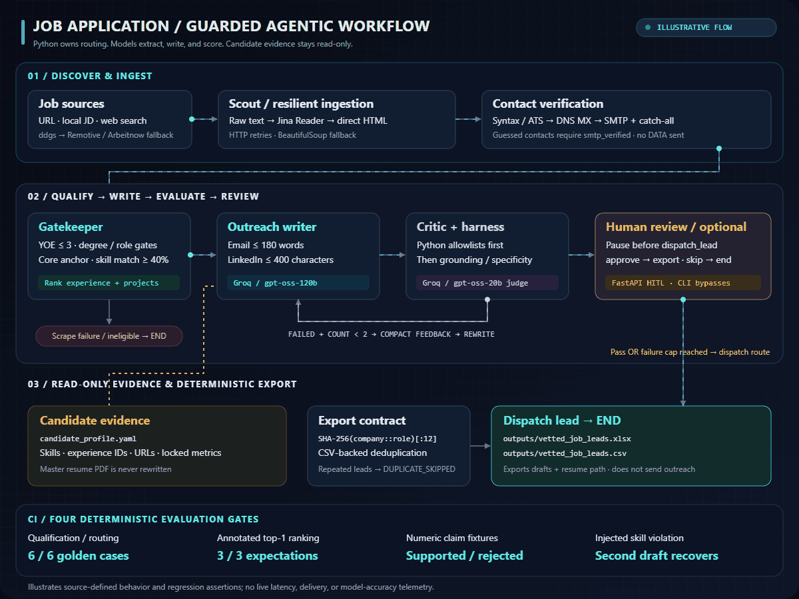
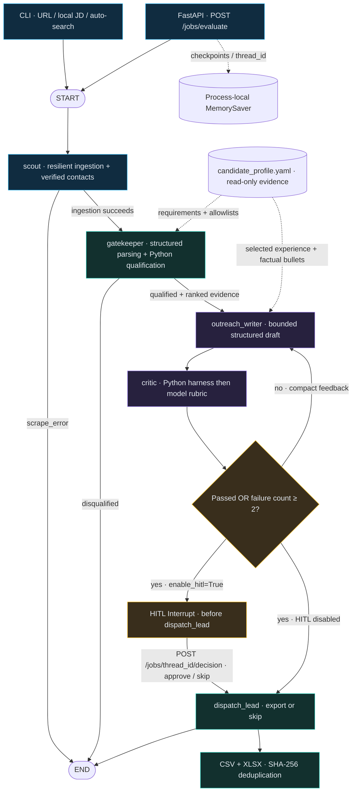
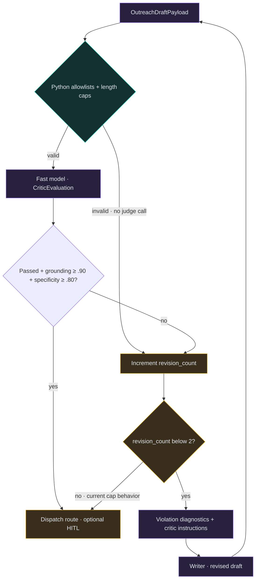
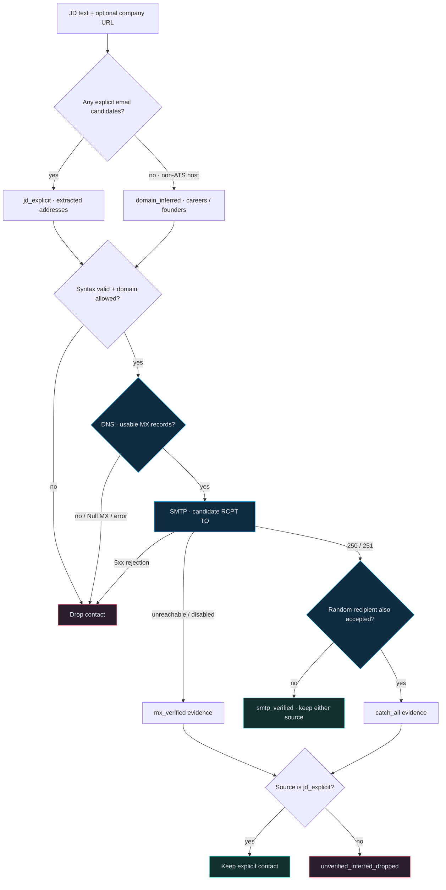

<div align="center">


</div>

# Job Application Agentic Workflow (LangGraph + FastAPI + Deterministic Harness)

Automates live job discovery, deterministic job-description (JD) qualification, resume experience ranking, and three-stage contact email verification through syntax filtering, DNS MX resolution, and non-sending SMTP probes. It drafts cold outreach toward a hallucination-free objective using profile allowlists, a writer–critic loop, and optional human review, without mutating the master resume; the current enforcement limits are documented below.

[](assets/animated-job-agent-flow.svg)

[Open the animated SVG](assets/animated-job-agent-flow.svg) · [Open the local preview](visual_env/index.html)

> **Runtime contract:** this animation shows the shipped workflow, not live telemetry. The failure ceiling still routes to dispatch, CLI runs bypass human review, and runtime allowlists check declared metadata rather than every prose claim. The four evaluation gates use deterministic fixtures; their targets do not establish live-model accuracy or guaranteed email delivery.

<p align="center">
  <a href="#architectural-philosophy-why-a-deterministic-agentic-workflow">Design</a> ·
  <a href="#system-topology--node-pipeline">Architecture</a> ·
  <a href="#contact-verification">Email verification</a> ·
  <a href="#evaluation-suite">Evaluations</a> ·
  <a href="#repository-structure">Repository</a> ·
  <a href="#quickstart--usage-with-uv">Quickstart</a>
</p>

## Architectural Philosophy: Why a Deterministic Agentic Workflow?

An unconstrained autonomous multi-agent swarm delegates planning, tool selection, and termination to models. That flexibility makes execution paths, token use, and failure recovery harder to reproduce. This repository uses a **Guarded Agentic Workflow**: explicit **Routing** selects eligible jobs, and an **Evaluator-Optimizer** loop supplies bounded feedback to the outreach writer.

Python owns graph edges, state transitions, qualification rules, ranking, allowlists, and export. The LLM has three structured contracts: JD extraction into `ParsedJD`, bounded copy generation into `OutreachDraftPayload`, and rubric scoring into `CriticEvaluation`. It does not choose tools or graph transitions. By default, Groq serves `openai/gpt-oss-20b` for parsing and judging and `openai/gpt-oss-120b` for writing; [llm_factory.py](src/job_agent/core/llm_factory.py) binds each model with `with_structured_output(schema)`.

The deterministic harness uses local Python comparisons before any critic model call. These are lightweight checks suitable for sub-millisecond execution on small payloads, but the repository has no enforced latency benchmark or SLA. A rejected draft incurs no LLM judge call; the writer receives compact violation diagnostics on the next attempt.

The factual source is [candidate_profile.yaml](src/job_agent/memory/candidate_profile.yaml): education, qualification rules, allowed skills, experience, project IDs, URLs, base bullets, and locked metrics. `assets/AzariushHussainResume.pdf` is the static master resume. The workflow exports its path and does not rewrite or attach the PDF to a sent message.

## System Topology & Node Pipeline

[workflow.py](src/job_agent/graph/workflow.py) compiles five nodes over the typed state in [state.py](src/job_agent/graph/state.py). The `audit_log` field accumulates node messages through an append reducer.

### 1. End-to-end system · shipped runtime



The interrupt is a LangGraph breakpoint before dispatch, not a sixth node. The CLI disables HITL; the FastAPI app enables it with a checkpointer.

### 2. Node contracts & control flow

**Scout — [scout.py](src/job_agent/graph/nodes/scout.py) and [scraper.py](src/job_agent/tools/scraper.py).** Ingests a JD through three tiers: supplied raw text of at least 40 stripped characters; Jina Reader Markdown at `https://r.jina.ai/{job_url}` with an 80-character minimum; then direct `httpx` retrieval and `BeautifulSoup` extraction with a 40-character minimum. The default fetcher uses `tenacity` for up to two attempts on `httpx.HTTPError`, with exponential backoff. HTML extraction removes scripts, styles, navigation, footers, and `noscript` content. Each successful tier invokes contact email verification. Failed ingestion ends the graph; an empty verified email list does not.

**Gatekeeper — [gatekeeper.py](src/job_agent/graph/nodes/gatekeeper.py) and [validators.py](src/job_agent/harness/validators.py).** The model extracts requirements; Python makes the qualification decision. `SKILL_ALIASES` normalizes variants such as `React` → `react.js`, `Postgres` → `postgresql`, and `SQS` → `aws sqs`. The supplied profile enforces:

- Required minimum experience **≤ 3.0 years** when specified. An omitted requirement is not rejected by this rule.
- A **B.Sc Computer Science** candidate is rejected when `strict_btech_be_only=True`, meaning the parser identifies an explicit B.Tech/B.E. requirement that excludes B.Sc/BCA.
- Target categories: `backend`, `full-stack`, `software_engineer`, `ai_engineer`, and `genai`. Intern, senior, and staff levels are excluded; configured title keywords also reject roles such as lead or principal.
- At least one core anchor among Python, JavaScript, Django, FastAPI, React.js, React Native, and Node.js when the JD specifies any must-have or nice-to-have skills.
- A must-have match ratio **≥ 40%**, computed as matched must-have entries divided by all must-have entries and rounded to two decimals. An empty must-have list receives `1.0`.

Ranking counts the normalized intersection of each item's stack with the JD's combined must-have and nice-to-have skills. It retains up to two positive-overlap experiences and two projects; ties preserve YAML order. With no overlap it falls back to the first profile item. The available experiences are `exp_lyfverse`, `exp_friggly`, and `exp_vibtree`; projects are `proj_quickchat` and `proj_webrtc`. Ranking runs even for a subsequently rejected JD.

**Outreach Writer — [outreach_writer.py](src/job_agent/graph/nodes/outreach_writer.py).** Produces an email body **≤ 180 whitespace-separated words** and a LinkedIn note **≤ 400 characters**. The prompt supplies the selected experiences and projects, their factual base bullets, allowed IDs and URLs, matched skills, and prior harness/critic feedback. Profile base bullets contain the locked numeric achievements used as writing evidence. Selected items are presented in profile order, rather than explicitly reordered by ranking score. The runtime allowlists accept any valid profile ID; they do not require references to be limited to the top-ranked subset.

**Critic & Deterministic Harness — [critic.py](src/job_agent/graph/nodes/critic.py) and [validators.py](src/job_agent/harness/validators.py).** Stage 1 checks `claimed_skills`, `referenced_experience_ids`, `referenced_project_ids`, `included_urls`, both length caps, and the presence of at least one experience or project reference. Failures short-circuit the judge and return explicit violations to the writer. Stage 2 asks the fast model for grounding and specificity scores; a pass requires `passed=True`, grounding **≥ 0.90**, and specificity **≥ 0.80**. Both types of failure increment `revision_count`.

**Revision semantics:** `max_revisions=2` is a ceiling on failed evaluations. Starting at zero, two consecutive failures produce two drafts, with one rewrite between them. The router advances to dispatch when the critic passes **or the ceiling is reached**, even if the latest harness or critic result failed. It does not fail closed at exhaustion.

**Dispatch & HITL Gate — [dispatch.py](src/job_agent/graph/nodes/dispatch.py) and [lead_exporter.py](src/job_agent/tools/lead_exporter.py).** With `enable_hitl=True`, compilation sets `interrupt_before=["dispatch_lead"]`; a caller provides a checkpointer and thread ID. `approve` resumes export, and `skip` returns `SKIPPED_BY_HUMAN`. Without a decision, dispatch defaults to approval. It writes `outputs/vetted_job_leads.xlsx` and `outputs/vetted_job_leads.csv`, including match details, outreach, recipient, job URL, UTC timestamp, and static resume path. Dispatch exports leads; it sends no email or LinkedIn message.

The idempotency key is the **first 12 hexadecimal characters of SHA-256** over `company_name.strip().lower() + "::" + role_title.strip().lower()`. A matching key in the CSV returns `DUPLICATE_SKIPPED`; a new row returns `EXPORTED`. Jobs with the same normalized company and title share a key even if their URLs differ.

**Current production boundaries.** The harness validates declared metadata, not every claim or URL in free-form prose. The critic prompt receives the draft and target role, but not the candidate's evidence; its score is not a factual proof. Dispatch prefers the writer's `recipient_email`, then the first verified discovery, then `careers@company.com`, without revalidating that choice. Review both content and recipient before acting on an exported lead.

The API uses process-local `MemorySaver` state, so pending reviews are lost on restart and are not shared across workers. It has no authentication layer. CSV and XLSX writes are sequential, without a lock or atomic transaction; the CSV is the deduplication source. Durable checkpoints, access control, and serialized or transactional export are deployment work beyond the current implementation.

### 3. Writer–critic recovery · bounded evaluator loop



The first harness failure supplies direct Python diagnostics to the next writer invocation. The second failure reaches the configured ceiling and advances; a reviewer must inspect the audit log before approval. This cap is a termination rule, not evidence that the final draft passed.

<a id="contact-verification"></a>

## 3-Stage Contact Email Verification Pipeline (`src/job_agent/tools/scraper.py`)

The pipeline reduces hard-bounce risk and potential sender reputation damage by qualifying candidate addresses before including them in `discovered_emails`. It does not guarantee delivery. Extraction lowercases and deduplicates regex matches. Only when there are **no explicit email candidates** does it infer `careers@{job_url_host}` and `founders@{job_url_host}` from a non-blocklisted host; it does not retry inference after explicit candidates fail verification.



**Stage 1 — Syntax & ATS Blocklist.** `EMAIL_REGEX.fullmatch` validates the candidate and rejects endings resembling image filenames (`.png`, `.jpg`, `.jpeg`, `.svg`, `.webp`, `.gif`). `ATS_AND_IGNORED_DOMAINS` contains 23 ATS, job-board, placeholder, and infrastructure domains, including `greenhouse.io`, `lever.co`, `ashbyhq.com`, `workday.com`, `myworkdayjobs.com`, `linkedin.com`, and `example.com`. The domain and its subdomains are blocked for both inference and explicit-address verification.

**Stage 2 — DNS MX Resolution.** `dnspython` resolves MX records with a default three-second lifetime and sorts exchangers by priority. Missing MX, NXDOMAIN, lookup failures, and RFC 7505 Null MX (`.`) yield no usable exchanger and `invalid_no_mx`. This rejects parked domains without usable MX; there is no separate parked-domain classifier, and MX presence alone does not prove an active mailbox.

**Stage 3 — Non-Sending SMTP RCPT TO & Catch-All Probe.** `smtplib` connects to the primary MX on port 25 with a default 3.5-second timeout, performs EHLO/HELO and `MAIL FROM`, and issues `RCPT TO` for the candidate. A `250` or `251` response triggers a second recipient probe at `_verify_probe_*@domain`. Acceptance of that random address marks the server `catch_all`; otherwise the candidate is `smtp_verified`. A candidate 5xx response is `smtp_rejected`; connection errors and other responses are treated as unreachable. The probe never issues `DATA` or sends a message.

| Evidence / probe outcome | Explicit JD address (`jd_explicit`) | Guessed address (`domain_inferred`) |
| --- | --- | --- |
| Candidate accepted; random probe not accepted | Keep: `smtp_verified` | Keep: `smtp_verified` |
| Candidate and random probe accepted | Keep: `catch_all` | Drop: `unverified_inferred_dropped` |
| Valid MX; SMTP unreachable or disabled | Keep: `mx_verified` | Drop: `unverified_inferred_dropped` |
| Candidate explicitly rejected by SMTP | Drop: `smtp_rejected` | Drop: `smtp_rejected` |
| Invalid syntax / blocked domain / no usable MX | Drop | Drop |

Explicit addresses may pass with `mx_verified`, `smtp_verified`, or `catch_all`. Inferred addresses require `smtp_verified`. Port 25 blocking therefore preserves explicit MX-backed contacts while suppressing guesses. SMTP responses and catch-all behavior remain evidence at probe time, not a promise of inbox delivery. The full verification report is returned by the scraper; Scout summarizes statuses in its audit log.

<a id="evaluation-suite"></a>

## Evaluation Suite & Production CI Gate (`tests/evals/`)

[test_eval_suite.py](tests/evals/test_eval_suite.py) defines four workflow evaluation tests. [.github/workflows/ci.yml](.github/workflows/ci.yml) runs unit tests and then evaluations as separate required-success steps on pushes and pull requests targeting `main`, using Python 3.12 and `pip install -e ".[dev]"`. Repository branch-protection requirements are not defined by this file.

| Core workflow evaluation metric | Enforced target | What the test actually measures |
| --- | --- | --- |
| Gatekeeper Qualification & Routing Accuracy | **100%** across `golden_jds.yaml` | All six prestructured JDs yield the expected eligibility and `outreach_writer` / `end` route. |
| Experience & Project Ranking Accuracy | **100% top-1 alignment** | Every annotated top result matches: two experience expectations and one project expectation. |
| End-to-End Fact & Numeric Metric Groundedness | **100% evidence match** for checked `%` and `$` claims | A valid authored fixture passes the metadata harness and numeric evidence helper; a fixture containing unsupported `85%` and `$50,000+` claims fails the helper. |
| Writer-Critic Loop Convergence | Recovery within **≤ 2 revisions** | An injected `Rust` claim fails the harness; a corrected second mock draft passes and exports. |

These are deterministic regression gates, not measured live-model accuracy. Parsing, writing, judging, DNS, and SMTP dependencies are injected or bypassed. The numeric helper checks regex-extracted percentage and dollar tokens against work-experience bullets and locked metrics in `candidate_profile.yaml`; it does not establish semantic attribution, inspect every number, or run inside the production critic. The convergence test demonstrates a scripted recovery, not recovery from every possible model failure.

The six golden benchmarks in [golden_jds.yaml](tests/evals/golden_jds.yaml) are:

| Case ID | Company / role focus | Expected qualification and route | Annotated top result |
| --- | --- | --- | --- |
| `eval_01_lyfverse_fastapi_payments` | FinFlow India — Python/FastAPI, payments, Redis | Accept → `outreach_writer` | Experience: `exp_lyfverse` |
| `eval_02_vibtree_django_rag_serverless` | VoiceAI Labs — Django, RAG, Lambda/SQS | Accept → `outreach_writer` | Experience: `exp_vibtree` |
| `eval_03_realtime_webrtc_websockets` | StreamSync — real-time full stack, WebRTC | Accept → `outreach_writer` | Project: `proj_webrtc` |
| `eval_04_reject_java_springboot_stack` | BankCorp — Java/Spring Boot stack | Reject → `end` | Not annotated |
| `eval_05_reject_strict_btech_gate` | GateKeep Tech — strict B.Tech/B.E. requirement | Reject → `end` | Not annotated |
| `eval_06_reject_senior_high_yoe` | CloudScale — senior/staff, six years required | Reject → `end` | Not annotated |

The last case rejects at the role-level check before reaching the YOE check. Unit coverage additionally exercises stack qualification, alias-aware ranking, allowlist violations, scraper fallback, inferred email policy, exporter idempotency, graph interruption/resumption, and API evaluate/approve behavior.

## Repository Structure

Tracked source and configuration are shown below. Python cache directories are omitted; `outputs/` is created at runtime.

```text
.
├── .github/
│   └── workflows/
│       └── ci.yml
├── .env.example
├── .gitignore
├── .python-version                  # Pins 3.15; CI uses 3.12
├── Dockerfile
├── README.md
├── pyproject.toml
├── uv.lock
├── assets/
│   ├── animated-job-agent-flow.svg  # Self-contained animated architecture
│   ├── infrastructure_and_evals.gif # Portable README hero rendered from the SVG
│   └── AzariushHussainResume.pdf    # Static master resume
├── scripts/
│   └── generate_visual_gif.py       # SVG-to-GIF renderer; uv script dependencies
├── visual_env/
│   └── index.html                   # Local SVG preview; no build required
├── src/
│   ├── job_agent/
│   │   ├── __init__.py
│   │   ├── cli.py
│   │   ├── api/
│   │   │   ├── __init__.py
│   │   │   └── main.py
│   │   ├── core/
│   │   │   ├── __init__.py
│   │   │   ├── config.py
│   │   │   └── llm_factory.py
│   │   ├── graph/
│   │   │   ├── __init__.py
│   │   │   ├── state.py
│   │   │   ├── workflow.py
│   │   │   └── nodes/
│   │   │       ├── __init__.py
│   │   │       ├── scout.py
│   │   │       ├── gatekeeper.py
│   │   │       ├── outreach_writer.py
│   │   │       ├── critic.py
│   │   │       └── dispatch.py
│   │   ├── harness/
│   │   │   ├── __init__.py
│   │   │   └── validators.py
│   │   ├── memory/
│   │   │   ├── __init__.py
│   │   │   └── candidate_profile.yaml
│   │   └── tools/
│   │       ├── __init__.py
│   │       ├── scraper.py
│   │       ├── job_search.py
│   │       └── lead_exporter.py
│   └── job_agent_system/
│       └── __init__.py               # Separate package stub
└── tests/
    ├── evals/
    │   ├── golden_jds.yaml
    │   └── test_eval_suite.py
    └── unit/
        ├── test_phase1_harness.py
        ├── test_phase2_loop.py
        ├── test_phase3_tools_and_hitl.py
        └── test_phase4_api.py
```

The SVG is the editable animation source. It uses CSS keyframes and SMIL motion with no JavaScript or external fonts. The README embeds a rendered GIF through standard Markdown for viewers that cannot display SVG or raw HTML images; the SVG remains linked above. The SVG preview respects reduced-motion preferences; the GIF plays independently of that preference. The header, typing line, and badges use external image services, matching the presentation of [production-rag](https://github.com/AzariushHussain/production-rag).

## Quickstart & Usage (with `uv`)

Run commands from the repository root: the implementation imports `src.job_agent`, and the defaults for `.env`, resume, and output files assume that working directory. `pyproject.toml` declares Python **≥ 3.11**; use **3.12** to match CI. The checked-in `.python-version` pins **3.15**, so explicitly select 3.12 for reproducible setup.

### Environment setup

Set the interpreter for the current shell before using the commands below:

```powershell
# PowerShell
$env:UV_PYTHON = "3.12"
```

```bash
# Bash / POSIX shell
export UV_PYTHON=3.12
```

Install runtime dependencies, then the optional test dependencies:

```bash
uv sync
uv sync --extra dev
```

Tests are an optional `dev` extra, not a default dependency group. A single `uv sync --extra dev --locked` installs everything while requiring the committed lockfile to remain current. A later plain `uv sync` removes unselected extras; select `--extra dev` again when installing test dependencies.

Copy `.env.example` to `.env` (`Copy-Item .env.example .env` in PowerShell or `cp .env.example .env` in Bash), then configure:

```dotenv
LLM_PROVIDER=groq
GROQ_API_KEY=your_groq_api_key_here
FAST_MODEL_NAME=openai/gpt-oss-20b
WRITER_MODEL_NAME=openai/gpt-oss-120b
TEMPERATURE=0.1
```

Live runs require the Groq key and network access. The offline demo and tests inject structured model responses and require no API key or tokens. Settings load `.env` through `pydantic-settings`; `.env` is ignored by Git. Edit the candidate YAML and static resume path for a different candidate before running live outreach.

### Full test and evaluation suite

After installing the `dev` extra as above:

```bash
uv run pytest -v
```

Alternatively, select the extra explicitly on the test command:

```bash
uv run --extra dev pytest -v
```

CI-equivalent targeted checks are `uv run --extra dev pytest tests/unit/ -v` and `uv run --extra dev pytest tests/evals/ -v`. Tests use temporary export directories.

### Offline demo — zero API tokens

```bash
uv run python -m src.job_agent.cli --demo
```

This injects fixed parser, writer, critic, MX, and SMTP responses; it performs no live discovery or verification. It writes the XLSX/CSV outputs and prints `dispatch_status` and `audit_log`. Repeating it returns `DUPLICATE_SKIPPED` if its company/title key already exists.

### Autonomous web job discovery

```bash
uv run python -m src.job_agent.cli --auto-search "Python FastAPI Bangalore" --max-jobs 3
```

[job_search.py](src/job_agent/tools/job_search.py) first queries `ddgs`, then fills missing results from the zero-auth Remotive and Arbeitnow APIs. URLs are deduplicated, capped at `--max-jobs`, and evaluated sequentially. Fallback matching uses broad keywords and may return remote or non-Bangalore roles; discovery does not guarantee location relevance, active vacancies, or any results during upstream failures.

### Single live URL or local JD file

```bash
# Replace the placeholder with a real public job-posting URL.
uv run python -m src.job_agent.cli --url "https://..."

# Supply your own UTF-8 file with at least 40 characters of JD text.
uv run python -m src.job_agent.cli --jd-file "path/to/job-description.txt"
```

`--jd-file` supplies raw text; it still uses live LLM calls and may perform DNS/SMTP checks. You may combine it with `--url` to retain the source URL and enable host-based contact inference. The CLI supports `--demo`, `--auto-search`, `--max-jobs`, `--url`, and `--jd-file`; use `uv run python -m src.job_agent.cli --help` for the parser's help. Demo takes precedence over search, and search takes precedence over single-job input. All CLI modes disable HITL and may export automatically, including at the critic failure ceiling.

### FastAPI HITL server

```bash
uv run uvicorn src.job_agent.api.main:app --reload --port 8000
```

The server exposes `GET /health`, interactive docs at `http://127.0.0.1:8000/docs`, `POST /jobs/evaluate`, and `POST /jobs/{thread_id}/decision`. The following `curl` examples use Bash/POSIX quoting:

```bash
curl -sS http://127.0.0.1:8000/health

curl -sS -X POST http://127.0.0.1:8000/jobs/evaluate \
  -H 'Content-Type: application/json' \
  -d '{"thread_id":"review_backend_001","raw_jd_text":"Hiring a Backend Engineer in Bangalore with 1-2 years of experience in Python, FastAPI and Redis. B.Sc Computer Science graduates are eligible."}'
```

The evaluation request accepts `job_url`, `raw_jd_text`, and an optional `thread_id`; omitting the ID generates one. Use a fresh ID per job. A URL-only request can supply `{"job_url":"https://your-company-domain/careers/role"}` instead. The response includes qualification, disqualification reason, skill match details, discovered emails, draft, audit log, and `waiting_for_human_approval`.

When `waiting_for_human_approval=true`, inspect the draft, recipient, and audit log before submitting either decision:

```bash
# Approve this pending thread and export the lead.
curl -sS -X POST http://127.0.0.1:8000/jobs/review_backend_001/decision \
  -H 'Content-Type: application/json' \
  -d '{"decision":"approve"}'

# Alternative for a pending thread: skip export.
curl -sS -X POST http://127.0.0.1:8000/jobs/review_backend_001/decision \
  -H 'Content-Type: application/json' \
  -d '{"decision":"skip"}'
```

Submit one decision for a pending review. The API accepts only `approve` and `skip`, returns HTTP 404 for an unknown thread, and returns `dispatch_status` after resumption. Disqualified or failed-ingestion runs end without an approval breakpoint. Keep the process alive between evaluation and decision: reloads and restarts discard its in-memory checkpoints. In Windows PowerShell, invoke the native client as `curl.exe` and adapt shell quoting, or use the interactive API docs.

### Architecture animation & local preview

Open the self-contained preview in a browser:

```powershell
Start-Process .\visual_env\index.html
```

Or open [assets/animated-job-agent-flow.svg](assets/animated-job-agent-flow.svg) directly. Edit that SVG to change labels, layout, or motion, then regenerate the README's GIF:

```bash
uv run scripts/generate_visual_gif.py
```

`uv` reads the script's inline dependency metadata and installs the rendering tools in an isolated environment. An equivalent invocation that selects the tools explicitly is:

```bash
uv run --with playwright --with pillow python scripts/generate_visual_gif.py
```

The renderer uses an installed Chrome/Edge/Chromium browser. If none is installed, run `uv run --with playwright python -m playwright install chromium` first. Rendering dependencies are not part of the application runtime.

The [preview page](visual_env/index.html) displays the source SVG directly. Commit the README together with both image assets so their relative links also resolve on GitHub.


